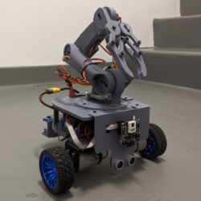
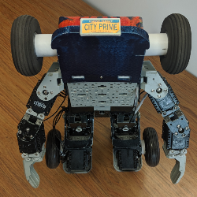

### Hi there 👋

You can call me Ria or Jean (pronounced like denim pants!).

I'm a Software Engineer with a strong interest in Robotics, Embedded Systems. I love making things, both in real life and digitally.

Projects I'm most proud of:

[Trilobyte Differential Drive Robot](https://github.com/ria-leberu/trilobyte) | [4-DOF Mobile Robotic Arm](https://github.com/ria-leberu/CET4811-CapstoneProject-4DOFMobileRobotArm) | [Transforming Robot](https://github.com/ria-leberu/city-tech-robotics-humanoid-project) 
-------------------------|-------------------------------------|-------------------|--------------------------------
C, C++, Python, ROS2, RP2040, ESP32, Rasberry Pi  | Arduino, C++ | Robotis Task and Motion Software | HTML, CSS, Javascript
[Picture] ||
A ROS2 Robot with SLAM and Manipulation | An open source, Arduino-based robotic arm using 3D printed parts. | A transforming humanoid robot, that turns into a small car. | An imaginary company that estimates total value of asteroids using NASA API
 | | | [Video Demo](https://youtu.be/h8BmeVW0j8s)
<!--
**ria-leberu/ria-leberu** is a ✨ _special_ ✨ repository because its `README.md` (this file) appears on your GitHub profile.

Here are some ideas to get you started:

- 🔭 I’m currently working on ...
- 🌱 I’m currently learning ...
- 👯 I’m looking to collaborate on ...
- 🤔 I’m looking for help with ...
- 💬 Ask me about ...
- 📫 How to reach me: ...
- 😄 Pronouns: ...
- ⚡ Fun fact: ...
-->
